

  <h1>Hi, I'm Ephantus 👋</h1>
  
<strong>AI Engineer · Cloud &amp; DevOps</strong>

  
Building dependable AI agents and the cloud-native systems around them.

  

    
    
    
    
  

### Profile dashboard

  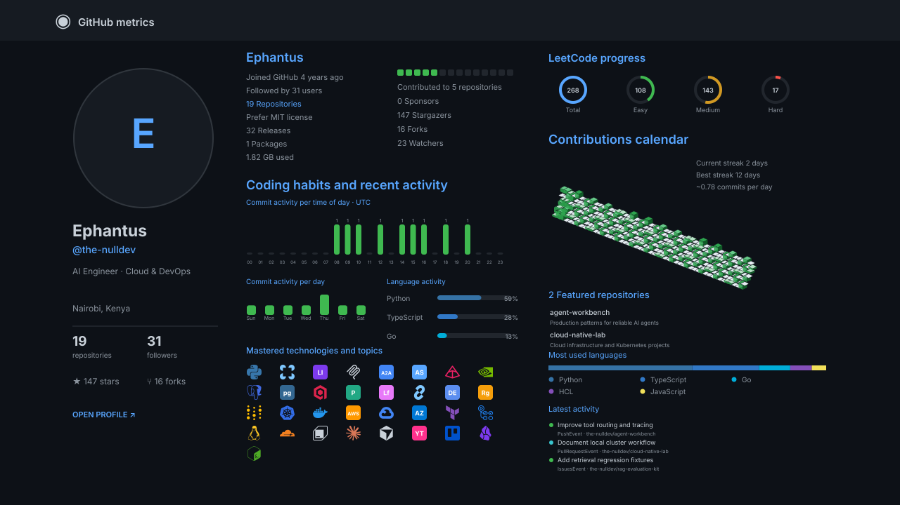

### Featured repositories

  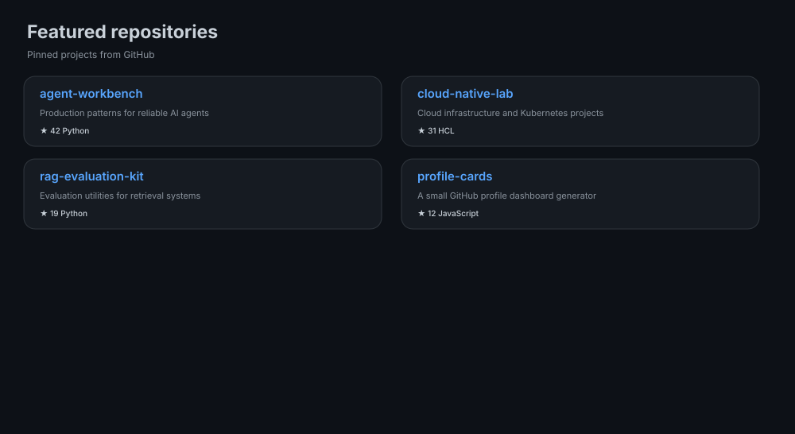

### Recent activity &amp; topics

<table>
  <tr>
    <td width="50%" valign="top"></td>
    <td width="50%" valign="top">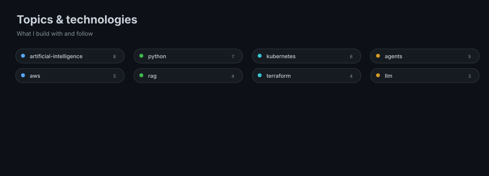</td>
  </tr>
</table>

### Tools I use

<table>
  <tr>
    <th>AI &amp; agents</th>
    <th>Data &amp; evaluation</th>
    <th>Cloud &amp; platform</th>
    <th>Workspace</th>
  </tr>
  <tr>
    <td>  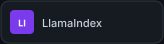  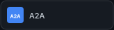 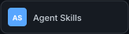 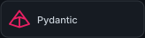 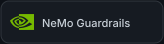</td>
    <td>  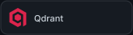      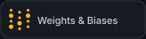</td>
    <td>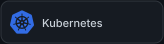  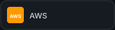 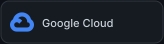 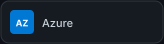 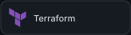 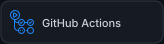 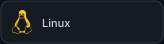 </td>
    <td> 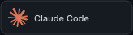   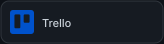 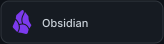 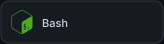</td>
  </tr>
</table>

### Certifications

<table>
  <tr>
    <td width="20%" align="center"> LangChain Certified Agent Engineer</td>
    <td width="20%" align="center"> Certified Kubernetes Administrator</td>
    <td width="20%" align="center"> Certified Kubernetes Application Developer</td>
    <td width="20%" align="center"> AWS Certified AI Practitioner</td>
    <td width="20%" align="center"> AWS Certified Cloud Practitioner</td>
  </tr>
  <tr>
    <td align="center"> Microsoft Security, Compliance, and Identity Fundamentals</td>
    <td align="center"> GitHub Foundations</td>
    <td align="center"> AWS Cloud Quest: Cloud Practitioner</td>
    <td align="center"> AWS Knowledge: Cloud Essentials</td>
    <td align="center"> IBM Cybersecurity Fundamentals</td>
  </tr>
</table>

### Beyond the code

<table>
  <tr>
    <td width="50%" valign="top"></td>
    <td width="50%" valign="top" align="center"><strong>Chess.com · Mr-Robot-7</strong>  <a href="https://www.chess.com/member/Mr-Robot-7/stats/rapid">Rapid · 1212</a> &nbsp;·&nbsp; <a href="https://www.chess.com/member/Mr-Robot-7/stats/blitz">Blitz · 940</a> <a href="https://www.chess.com/member/Mr-Robot-7/stats/all-brilliant-moves">Brilliant moves</a></td>
  </tr>
</table>

### About these cards

The dashboard and every tool badge are generated in this repository with dependency-free Node.js scripts and rendered as self-contained SVGs in a dark GitHub/Material-inspired style. Brand paths are vendored from Simple Icons v16.35.0 (CC0); tools without an available brand path use a colored monogram. GitHub refreshes the cards daily at **06:00 UTC**; run **Refresh profile cards** in the Actions tab to update them manually. The workflow uses the built-in `GITHUB_TOKEN` by default; setting an optional `METRICS_TOKEN` secret can provide additional API quota. The LeetCode card uses the public handle `the-null-dev`.

AI engineering · cloud-native tools · open-source collaboration

