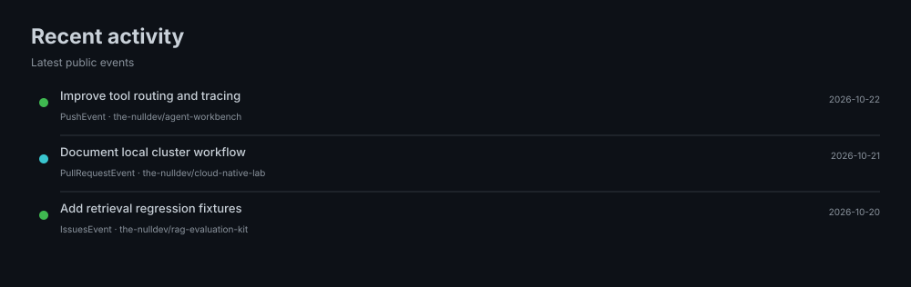
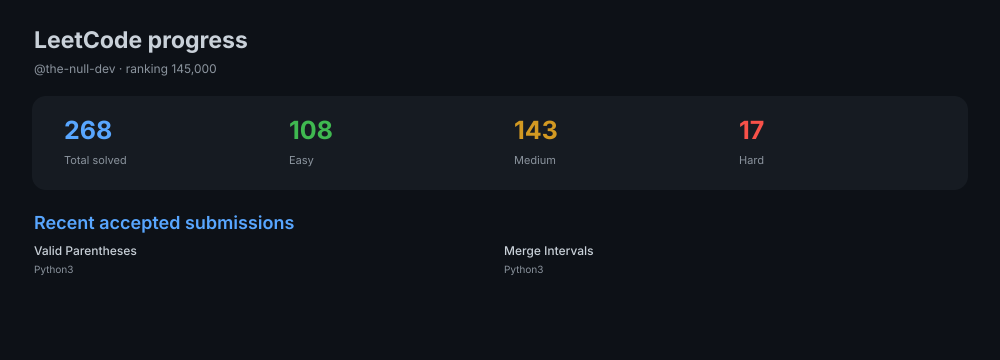

  <h1>Hi, I'm Ephantus 👋</h1>
  
<strong>AI Engineer · Cloud &amp; DevOps</strong>

  

    
    
    
    
  

### Tools I use

<table>
  <tr>
    <td width="50%" align="center" valign="top">
      <strong>AI &amp; agents</strong>  
      
      
      
      
      
      
      
      
    </td>
    <td width="50%" align="center" valign="top">
      <strong>Vector databases &amp; data</strong>  
      
      
      
      
    </td>
  </tr>
  <tr>
    <td width="50%" align="center" valign="top">
      <strong>Evaluation &amp; observability</strong>  
      
      
      
      
      
    </td>
    <td width="50%" align="center" valign="top">
      <strong>Workspace &amp; AI coding</strong>  
      
      
      
      
      
      
      
    </td>
  </tr>
  <tr>
    <td width="100%" align="center" valign="top" colspan="2">
      <strong>Cloud &amp; platform</strong>  
      
      
      
      
      
      
      
      
      
    </td>
  </tr>
</table>

### Featured repositories

### GitHub activity

<table>
  <tr>
    <td width="50%" valign="top">
      <strong>GitHub stats</strong> 
      
    </td>
    <td width="50%" valign="top">
      <strong>Top languages</strong> 
      
    </td>
  </tr>
  <tr>
    <td width="50%" valign="top">
      <strong>GitHub streak</strong> 
      
    </td>
    <td width="50%" valign="top">
      <strong>Recent activity</strong> 
      
    </td>
  </tr>
  <tr>
    <td width="50%" valign="top">
      <strong>Languages in motion</strong> 
      
    </td>
    <td width="50%"></td>
  </tr>
</table>

### Certifications

<table>
  <tr>
    <td width="20%" align="center" valign="top">
       
      LangChain Certified Agent Engineer
    </td>
    <td width="20%" align="center" valign="top">
       
      Certified Kubernetes Administrator (CKA)
    </td>
    <td width="20%" align="center" valign="top">
       
      Certified Kubernetes Application Developer (CKAD)
    </td>
    <td width="20%" align="center" valign="top">
       
      AWS Certified AI Practitioner
    </td>
    <td width="20%" align="center" valign="top">
       
      AWS Certified Cloud Practitioner
    </td>
  </tr>
  <tr>
    <td width="20%" align="center" valign="top">
       
      Microsoft Security, Compliance, and Identity Fundamentals
    </td>
    <td width="20%" align="center" valign="top">
       
      GitHub Foundations
    </td>
    <td width="20%" align="center" valign="top">
       
      AWS Cloud Quest: Cloud Practitioner
    </td>
    <td width="20%" align="center" valign="top">
       
      AWS Knowledge: Cloud Essentials
    </td>
    <td width="20%" align="center" valign="top">
       
      IBM Cybersecurity Fundamentals
    </td>
  </tr>
</table>

### Open-source radar · repositories &amp; topics I follow

#### Star-list repositories &amp; languages

#### Starred topics

<table>
  <tr>
    <td width="50%" valign="top">
      <strong>Topic icons</strong> 
      
    </td>
    <td width="50%" valign="top">
      <strong>Topic labels</strong> 
      
    </td>
  </tr>
</table>

### Beyond the code

<table>
  <tr>
    <td width="50%" valign="top">
      <strong>LeetCode</strong> 
      
    </td>
    <td width="50%" valign="top" align="center">
      <strong>Chess.com</strong>  
        
       
       
      
    </td>
  </tr>
</table>

### Profile repository &amp; metrics setup

The [Metrics workflow](.github/workflows/metrics.yml) refreshes the profile cards daily at **06:00 UTC** and can also be run manually. The workflow uses GitHub's built-in `GITHUB_TOKEN`; no `METRICS_TOKEN` or LeetCode token is required. The LeetCode card is configured for the handle `the-null-dev`.

Run **Refresh profile metrics** from the repository's Actions tab to generate or update the cards.

  AI engineering · cloud-native tools · open-source collaboration

